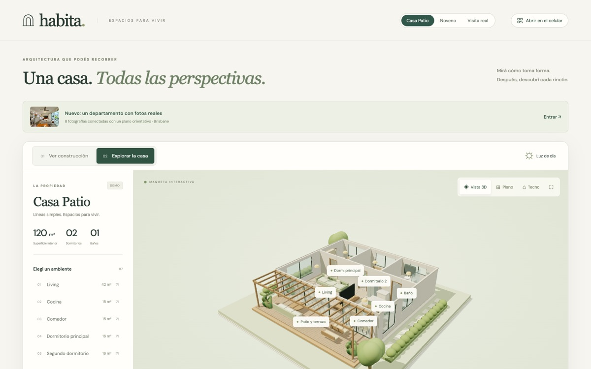
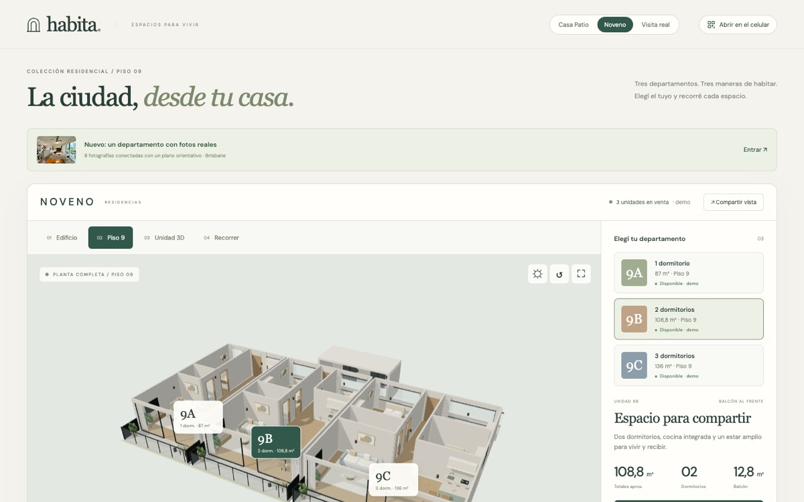
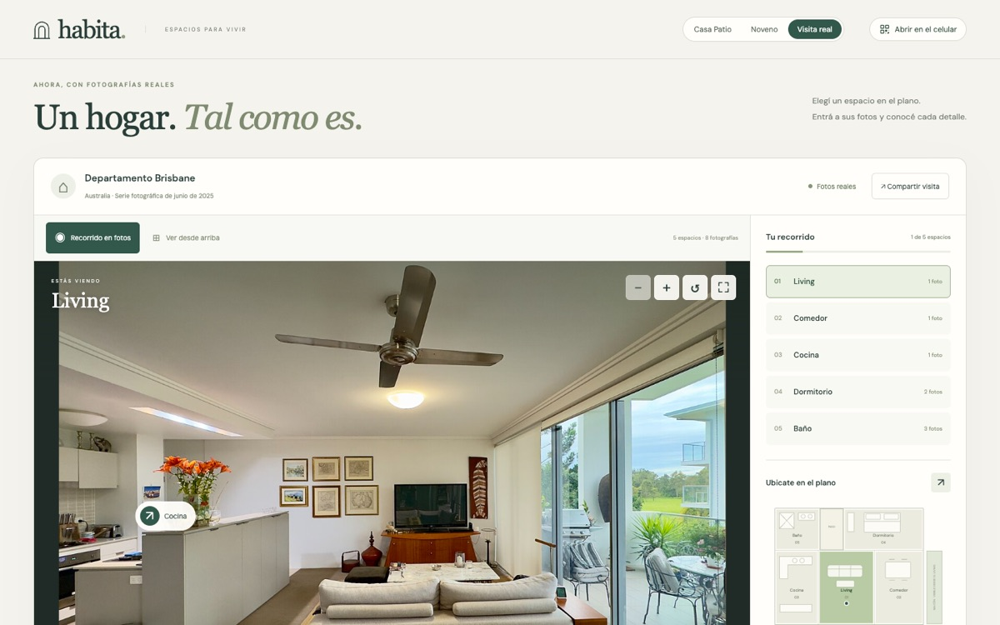

# Habita · Prototipo inmobiliario 3D

[](https://github.com/geroo03/inmobiliaria-c-rdoba-3D/actions/workflows/pages.yml)

Tres maneras de mostrar una propiedad en el navegador, sin instalar nada y desde PC o celular: **ver cómo se construye** una casa, **recorrer departamentos en 3D** y **visitar un departamento real** a partir de sus fotos.

**[Abrir las demos →](https://geroo03.github.io/inmobiliaria-c-rdoba-3D/)**

## Demos

<table>
  <tr>
    <td width="33%" valign="top">
      <a href="https://geroo03.github.io/inmobiliaria-c-rdoba-3D/"></a>
      <h3><a href="https://geroo03.github.io/inmobiliaria-c-rdoba-3D/">Casa Patio</a></h3>
      Construcción animada en 9 etapas y recorrido a pie por los 7 ambientes de una casa.<br>
      <sub>Modelo 3D ficticio · Three.js</sub><br>
      <a href="docs/demos/casa-patio.md">Ficha de la demo</a>
    </td>
    <td width="33%" valign="top">
      <a href="https://geroo03.github.io/inmobiliaria-c-rdoba-3D/noveno/"></a>
      <h3><a href="https://geroo03.github.io/inmobiliaria-c-rdoba-3D/noveno/">Noveno</a></h3>
      Tres departamentos en un piso 9: compararlos, entrar a cada uno y salir al balcón.<br>
      <sub>Modelo 3D ficticio · Three.js</sub><br>
      <a href="docs/demos/noveno.md">Ficha de la demo</a>
    </td>
    <td width="33%" valign="top">
      <a href="https://geroo03.github.io/inmobiliaria-c-rdoba-3D/visita-real/"></a>
      <h3><a href="https://geroo03.github.io/inmobiliaria-c-rdoba-3D/visita-real/">Visita real</a></h3>
      Un departamento real en 8 fotos: elegir el ambiente en un plano, ampliar y compartir.<br>
      <sub>Fotos reales con licencia libre · sin WebGL</sub><br>
      <a href="docs/demos/visita-real.md">Ficha de la demo</a>
    </td>
  </tr>
</table>

> [!IMPORTANT]
> Ninguna demo es una propiedad en venta. Casa Patio y Noveno son modelos generados por código. La Visita real usa fotos de un departamento de Brisbane publicadas con licencia CC BY-SA 4.0 y un plano orientativo, sin medidas verificadas.

## Del prototipo a una propiedad real

Las demos marcan tres niveles posibles para mostrar un inmueble existente:

1. **Fotos y plano** → una visita por ambientes como la **Visita real**. Se puede hacer con fotos comunes.
2. **Panoramas 360° y plano** → mirar alrededor desde cada punto de cada ambiente.
3. **Modelo fiel o captura espacial** → maqueta y recorrido libre como en **Casa Patio** o **Noveno**, pero de la propiedad real.

Primer paso concreto: elegir una propiedad, completar su ficha y conseguir el plano. Está todo en **[Por dónde empezar](docs/producto/por-donde-empezar.md)**.

## Para presentar y compartir

- **Abrir en el celular:** en una laptop o un proyector, el botón del encabezado muestra un QR de la vista actual para que el público la abra en su teléfono.
- **Vista previa en WhatsApp:** al pegar el enlace de cualquier demo aparece una imagen con su título y descripción.
- **Consultar por WhatsApp:** cada unidad de Noveno y la Visita real tienen un botón con el mensaje ya escrito. El número de la inmobiliaria se configura en `dist/contact.js` ([cómo](docs/tecnico/arquitectura.md#configurar-el-contacto-por-whatsapp)).

## Inicio rápido

```sh
git clone https://github.com/geroo03/inmobiliaria-c-rdoba-3D.git
cd inmobiliaria-c-rdoba-3D
npm start    # sirve el sitio en http://127.0.0.1:4173
npm test     # 25 pruebas, sin instalar dependencias
```

Requisitos: Python 3 para el servidor local, Node.js 20 o posterior para las pruebas y un navegador con WebGL para las demos 3D. En Mac también se puede hacer doble clic en `scripts/ABRIR_PROTOTIPO.command`.

No hay compilación ni dependencias que instalar: el sitio es estático y trae sus recursos (Three.js y la tipografía) en `dist/vendor/`.

## Estructura

```text
dist/                Sitio publicado
├── index.html …     Casa Patio y módulos 3D compartidos
├── noveno/          Noveno
├── visita-real/     Visita real (datos, visor y fotos)
├── og/              Imágenes de vista previa para compartir
└── vendor/          Three.js y DM Sans, con sus licencias
docs/                Documentación (índice en docs/README.md)
tests/               Pruebas con node:test
scripts/             Lanzador para Mac
.github/workflows/   Publicación en GitHub Pages
```

## Documentación

| Documento | Para qué |
| --- | --- |
| [Por dónde empezar](docs/producto/por-donde-empezar.md) | Pasos, ficha y checklist para la primera propiedad real |
| [Guía de producción real](docs/producto/guia-produccion-real.md) | Qué permite cada material, alternativas (proveedor, editor o desarrollo propio) y arquitectura propuesta |
| [Casa Patio](docs/demos/casa-patio.md) · [Noveno](docs/demos/noveno.md) · [Visita real](docs/demos/visita-real.md) | Qué hace cada demo, controles, enlaces y código |
| [Documentación técnica](docs/tecnico/arquitectura.md) | Módulos, pruebas, publicación y estado de calidad |
| [Créditos y licencias](docs/creditos-y-licencias.md) | Fotos, tipografía y librerías de terceros |
| [CHANGELOG](CHANGELOG.md) | Qué cambió en cada versión y cómo se verificó |

El [índice de la documentación](docs/README.md) incluye un glosario.

## Publicación

Cada cambio en `dist/`, `tests/` o `package.json` que llega a `main` se comprueba y se publica solo en GitHub Pages mediante [pages.yml](.github/workflows/pages.yml). Solo se publica `dist/`; la documentación se lee desde este repositorio. Detalles en la [documentación técnica](docs/tecnico/arquitectura.md#publicación).

## Licencia y créditos

Código, diseño y documentación: todos los derechos reservados (ver [LICENSE](LICENSE)).

Material de terceros, con sus propias licencias: fotos de la Visita real de Chris Olszewski / Wikimedia Commons, [CC BY-SA 4.0](https://creativecommons.org/licenses/by-sa/4.0/); [Three.js](https://threejs.org/) (MIT) y DM Sans (SIL OFL 1.1). Detalle por archivo en [créditos y licencias](docs/creditos-y-licencias.md).
