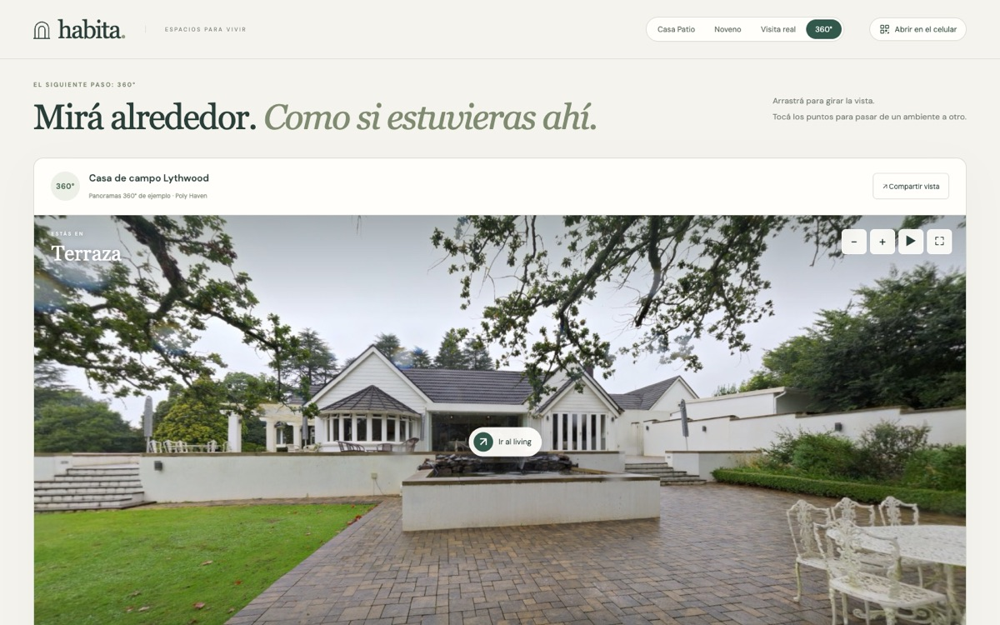

# Recorrido 360°: mirar alrededor, ambiente por ambiente

**Demo:** https://geroo03.github.io/inmobiliaria-c-rdoba-3D/visita-360/ · **Contenido:** 3 panoramas 360° reales con licencia CC0 · **Tecnología:** Three.js sobre WebGL · **Dispositivos:** PC y celular

Captura de la demo. Panorama: Greg Zaal / Poly Haven, CC0.

## En una frase

Un recorrido por panoramas 360°: el visitante gira la vista en todas las direcciones desde cada punto y pasa de la terraza al living y al dormitorio tocando los puntos de paso.

## Por qué importa esta demo

Es el **segundo nivel** del camino hacia una propiedad real ([README](../../README.md#del-prototipo-a-una-propiedad-real)): con fotos comunes se arma una visita por encuadres, como la [Visita real](visita-real.md); con panoramas 360° se puede mirar el ambiente completo, techo y piso incluidos. Es el formato de los recorridos virtuales que ofrecen las plataformas especializadas, hecho acá con un visor propio, sin servicios externos y con el mismo diseño que las otras demos.

## Qué propiedad se muestra

Tres panoramas de un mismo lugar, **Lythwood**, una casa de campo fotografiada por **Greg Zaal** y publicada en Poly Haven con licencia **CC0** (dominio público).

> [!IMPORTANT]
> No contamos con el plano de la casa: **las conexiones entre ambientes son orientativas**. La propiedad no se ofrece en venta y el autor no patrocina la demo. La página lo aclara junto al visor.

## Ambientes

| N.º | Ambiente | Puntos de paso |
| --- | --- | --- |
| 01 | Terraza | Ir al living (sobre la entrada de la casa) |
| 02 | Living | Salir a la terraza (ventanales) · Ir al dormitorio (puerta de madera) |
| 03 | Dormitorio | Volver al living (puerta) |

## Qué se puede hacer

- **Mirar alrededor** arrastrando, con inercia al soltar. La vista sigue al dedo o al mouse.
- **Acercar y alejar** con los botones, pellizcando en el celular, o con la rueda en pantalla completa o con Ctrl. Fuera de la pantalla completa la rueda desplaza la página, para no trabarla.
- **Giro automático al abrir:** la vista gira despacio hasta la primera interacción, ideal para una presentación. Se pausa y se reanuda con su botón. Se desactiva si el sistema pide reducir el movimiento.
- **Pasar de un ambiente a otro** con los puntos sobre el panorama o con las tarjetas de ambientes, que muestran el progreso («2 de 3 ambientes»).
- **Pantalla completa**, con un modo ampliado alternativo cuando el navegador no la permite (iPhone).
- **Compartir** el enlace de un ambiente, **abrirlo en el celular** con el QR del encabezado y **consultar por WhatsApp**.
- **Carga en dos etapas:** primero una vista previa liviana (1024 × 512) y después la versión en alta (4096 × 2048). Al cambiar de ambiente se libera la versión en alta anterior, para no saturar la memoria del celular.
- **Sin WebGL**, la página lo avisa y ofrece abrir el panorama del living como imagen.

### Controles

| Acción | PC | Celular |
| --- | --- | --- |
| Mirar alrededor | Arrastrar · flechas del teclado con el foco en el visor | Arrastrar con un dedo |
| Acercar o alejar | Botones **+** / **−** · teclas **+** / **−** · Ctrl + rueda | Pellizcar · botones |
| Cambiar de ambiente | Puntos sobre el panorama o tarjetas | Igual |
| Giro automático | Botón ❚❚ / ▶ | Igual |

## Enlaces para compartir

| Parámetro | Valores | Si falta o no es válido |
| --- | --- | --- |
| `escena` | `terraza`, `living`, `dormitorio` | `terraza` |

Ejemplo: [`visita-360/?escena=dormitorio`](https://geroo03.github.io/inmobiliaria-c-rdoba-3D/visita-360/?escena=dormitorio). Al compartir, el enlace se genera limpio, solo con este parámetro. Los enlaces son públicos.

## Código

| Archivo | Responsabilidad |
| --- | --- |
| [dist/visita-360/index.html](../../dist/visita-360/index.html) | Estructura, textos, créditos y diálogo de compartir |
| [dist/visita-360/styles.css](../../dist/visita-360/styles.css) | Estilo y adaptación a celular |
| [dist/visita-360/app.js](../../dist/visita-360/app.js) | Visor: esfera con el panorama, arrastre, zoom, giro automático, puntos de paso, carga en dos etapas, pantalla completa |
| [dist/visita-360/data.js](../../dist/visita-360/data.js) | Propiedad, créditos, escenas, vista inicial, puntos de paso, lectura de enlaces y cálculo de direcciones |
| [dist/visita-360/panoramas/](../../dist/visita-360/panoramas/) | Panoramas en alta (4096 × 2048) y vistas previas (1024 × 512) |
| [tests/visita-360.test.mjs](../../tests/visita-360.test.mjs) | 4 pruebas: panoramas 2:1 con fuente, puntos de paso válidos y escenas alcanzables, enlaces seguros, ángulos |

## Cómo cargar panoramas propios

1. **Capturar** un panorama por ambiente con una cámara 360° (por ejemplo, Insta360 o Ricoh Theta), con la cámara a la altura de los ojos y en el centro del ambiente. Sumar puntos en pasillos o donde una pared tape partes importantes.
2. **Exportar** cada panorama como JPG equirectangular (proporción 2:1) y generar dos tamaños: 4096 × 2048 y una vista previa de 1024 × 512.
3. **Cargar los datos** en `data.js`: por cada escena, `id`, `name`, `number`, `description`, archivos, `start` (hacia dónde mira al entrar) y `hotspots` (a qué escena lleva cada punto y dónde está).
4. **Ubicar los puntos de paso:** sobre el panorama de 2:1, un punto en la posición `x`, `y` (en píxeles) corresponde a `yaw = (x / ancho − 0,5) × 360` y `pitch = (0,5 − y / alto) × 180`. El yaw crece hacia la derecha y el pitch hacia arriba.
5. **Actualizar** los créditos de la página y del diálogo, y correr `npm test`: las pruebas verifican proporción y tamaño de los panoramas, que cada punto lleve a una escena existente y que todas las escenas se puedan alcanzar.
6. **Con plano medido**, ubicar los puntos de paso en las puertas reales y quitar el aviso de conexiones orientativas.

---

Historial de versiones y verificaciones: [CHANGELOG](../../CHANGELOG.md) · Arquitectura y pruebas: [documentación técnica](../tecnico/arquitectura.md)
