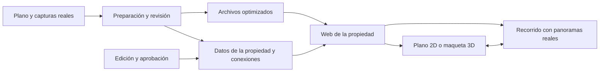

# De Habita a una visita virtual de propiedades reales

Fecha de revisión: 18 de octubre de 2026.

## 1. El producto que querés lograr

Un cliente recibe un enlace de una propiedad, lo abre en el navegador de su PC o celular y puede:

1. Entender desde arriba cómo se distribuye la vivienda.
2. Seleccionar el living, un dormitorio u otro ambiente.
3. Ver ese lugar tal como fue fotografiado o capturado.
4. Mirar alrededor y pasar a otros puntos disponibles.
5. Volver al plano sin perderse.

En PC, el plano y el recorrido pueden verse lado a lado. En celular, conviene que el recorrido ocupe la pantalla y que el plano se abra con un botón visible. La experiencia debe funcionar en ambos; la PC permite apreciar más detalle y mantener más información a la vista.

Para visitar, el objetivo es abrir un enlace sin instalar una aplicación. La captura y la preparación del contenido son trabajos separados de la visita del cliente.

## 2. Qué material permite cada resultado

| Material disponible | Resultado que podemos construir | Trabajo adicional |
| --- | --- | --- |
| Fotos comunes de una publicación | Galería real por ambiente, accesible desde un plano (ejemplo: [Visita real](../demos/visita-real.md)) | Identificar qué muestra cada foto y conseguir el plano |
| Fotos 360° completas | Mirar alrededor desde cada punto fotografiado y saltar a otros puntos | Ubicar los puntos y conectar el recorrido |
| Plano real y panoramas 360° | Vista superior seleccionable conectada con interiores reales | Dibujar zonas y asociarlas con sus panoramas |
| Modelo 3D fiel y panoramas 360° | Maqueta sin techo desde arriba, con acceso a imágenes reales | Preparar el modelo y alinear ambientes y capturas |
| Captura espacial procesada | Modelo navegable de la propiedad, según el sistema utilizado | Capturar con el flujo compatible, procesar y revisar |
| Modelo arquitectónico de una obra futura | Vista 3D y recorridos de un proyecto | Renderizar e identificar el contenido como proyecto |

**Una carpeta de fotos comunes no alcanza, por sí sola, para reconstruir de forma fiable toda la vivienda y verla desde cualquier ángulo.** No muestra necesariamente todas las paredes, conexiones o superficies. Se puede usar como inicio de una galería y también como referencia para un modelado, pero la geometría necesita información adicional.

Una foto 360° permite girar desde el punto de captura. Para acercarse a una ventana o mirar detrás de un mueble hace falta otro punto capturado o una reconstrucción 3D que contenga esa información. Una transición animada entre panoramas no agrega los lugares que no se fotografiaron.

El plano superior puede ser un dibujo 2D fiel o una maqueta 3D. Si querés que el cliente también gire toda la vivienda como en el prototipo, hay que incluir explícitamente esa maqueta en el alcance.

## 3. Recomendación para tu caso

Empezaría con **una sola propiedad real, su plano y panoramas reales de sus ambientes**. El primer resultado debe demostrar que el cliente entiende la distribución y ve el interior correcto al seleccionarlo.

Para una solución propia, usaría primero un plano seleccionable conectado a panoramas; después incorporaría una maqueta 3D fiel al mismo plano. Si la maqueta de toda la propiedad es indispensable desde la primera entrega, evaluaría una captura profesional con una plataforma especializada antes de desarrollar la reconstrucción por cuenta propia.

La captura es la primera decisión. Programar más detalles sobre la casa ficticia no reemplaza conseguir el material de una vivienda real.

## 4. Tres caminos de implementación

### A. Captura y plataforma especializada

Matterport es una opción a evaluar para una primera propiedad con captura espacial y vista de conjunto. Su documentación presenta distintas formas de captura y una vista tipo maqueta o *dollhouse*. También permite compartir o integrar recorridos en una web. Estas son capacidades del proveedor, cuya disponibilidad concreta hay que confirmar para el equipo y servicio contratados. [Métodos de captura](https://matterport.com/how-to-capture), [vista Dollhouse](https://matterport.com/en-gb/blog/dollhouse-view-just-got-upgrade), [formas de compartir](https://matterport.com/blog/new-way-sharing-your-spaces).

Nuestra web contendría la ficha inmobiliaria y el recorrido integrado. Un visor externo conserva sus propios controles; si queremos que botones personalizados de nuestra interfaz controlen sus ambientes, hay que verificar primero la integración que ofrece.

Antes de contratar, pedir una demostración con material equivalente y confirmar precio de captura, alojamiento, propiedades activas, acceso de clientes, exportaciones, cambios y continuidad si termina el servicio. Revisar los [planes del proveedor](https://matterport.com/plans); este documento no fija precios ni garantiza disponibilidad de fotógrafos en tu localidad.

**Elegirlo cuando:** la prioridad sea conseguir pronto una visita real completa con un flujo de captura existente.

### B. Autoría de recorridos con una herramienta visual

3DVista permite vincular planos con panoramas mediante áreas seleccionables. Su oferta también contempla modelos 3D existentes conectados a las vistas del recorrido. Hay que producir esos panoramas y, cuando corresponda, el modelo; importar una foto común no genera automáticamente la casa completa. [Planos interactivos](https://www.3dvista.com/en/kb/faqs/interactivity/can-i-add-floor-plans-and-make-them-interact-with-my-virtual-tours/), [capacidades del producto](https://www.3dvista.com/en/).

Es un camino para que alguien prepare los tours desde un editor y luego los publique o integre en la web inmobiliaria. Conviene comprobar con un proyecto de prueba qué formatos, edición y alojamiento se ajustan al trabajo del equipo.

**Elegirlo cuando:** se quiera una herramienta de autoría y control del resultado sin construir todo el editor desde cero.

### C. Desarrollo propio con plano y visor 360°

Podemos adaptar la interfaz de Habita y conectar un plano SVG o un modelo propio con un visor panorámico como Marzipano. Su herramienta admite panoramas esféricos equirectangulares con proporción 2:1 o caras de cubo y permite exportar una aplicación web. El plano de la propiedad y su correspondencia con las escenas deben agregarse como parte del proyecto. [Formatos y exportación](https://www.marzipano.net/tool/), [visor y documentación](https://www.marzipano.net/).

**Elegirlo cuando:** se quiera controlar la experiencia, los archivos y la evolución del sistema, asumiendo el desarrollo y mantenimiento.

| Criterio | Plataforma especializada | Herramienta de autoría | Desarrollo propio |
| --- | --- | --- | --- |
| Quién arma el recorrido | Flujo del proveedor y operador de captura | Operador del editor | Aplicación y equipo propio |
| Plano y vista desde arriba | Confirmar resultado de la captura | Importar y configurar | Implementar y validar |
| Interiores reales | Captura compatible | Panoramas aportados | Panoramas aportados |
| Maqueta 3D | Confirmar con el servicio elegido | Aportar modelo compatible | Modelar o importar |
| Personalización | Dentro de lo permitido por la integración | Según editor y exportación | Según lo que construyamos |
| Operación recurrente | Contrato y alojamiento del proveedor | Licencia, captura y alojamiento | Captura, alojamiento y mantenimiento |

Esta comparación organiza decisiones; no es una medición de costo o calidad entre productos.

## 5. Cómo preparar una propiedad real

### Plano

Conseguir el plano actual y verificarlo en el lugar. Debe permitir identificar niveles, puertas, conexiones y nombres de ambientes. Si no existe, hay que relevar la distribución y dibujarla. Las superficies que se publiquen deben provenir de documentación o mediciones identificadas; las cifras de la demo no se reutilizan.

Asignar un identificador estable a cada ambiente y marcar sobre el plano todos los puntos donde se hicieron capturas. Una habitación puede tener varios puntos.

### Fotografías y panoramas

Para un piloto con panoramas, contratar una captura o usar equipo que entregue un panorama esférico completo, nivelado y bien unido. Una panorámica horizontal del modo habitual de un celular no necesariamente cubre toda la esfera.

Propuesta de trabajo para la primera vivienda:

- Capturar al menos un punto útil de cada ambiente que se mostrará.
- Añadir puntos donde una pared, un pasillo o una esquina oculten partes relevantes.
- Mantener una altura y exposición coherentes entre escenas.
- Mantener puertas y muebles en posiciones consistentes durante la sesión.
- Revisar espejos, ventanas, uniones de imagen y zonas sin cobertura antes de terminar.
- Guardar originales y copias de publicación por separado.

La cantidad final de capturas se determina recorriendo la propiedad. No hay una cantidad universal por metro cuadrado.

Con un proveedor de captura espacial, seguir su protocolo y solicitar una revisión del modelo completo, no solamente una imagen atractiva de la entrada.

### Correspondencia entre plano e interior

Cada zona del plano debe abrir una escena de ese ambiente. Además hay que configurar la dirección inicial de la mirada y las conexiones disponibles. Por ejemplo: al entrar desde el plano al living, la primera vista debe permitir reconocerlo; un punto en la puerta de la cocina debe llevar a la escena prevista, y el regreso debe ser posible.

## 6. Arquitectura propuesta para una versión propia



Para el primer piloto, los datos pueden vivir en un JSON validado y los archivos publicarse con la web. Un catálogo mayor puede usar una base de datos y almacenamiento de medios con distribución por CDN. Un panel de edición se justifica cuando otra persona necesite cargar propiedades sin tocar código.

Separaría estas piezas:

| Pieza | Responsabilidad |
| --- | --- |
| Datos de propiedad | Nombre, estado, plantas, ambientes y referencias a medios |
| Plano | Zonas seleccionables y posición de escenas |
| Visor 360° | Carga, orientación y cambio de panorama |
| Modelo 3D opcional | Vista de conjunto y correspondencia con los ambientes |
| Publicación | Mostrar únicamente una versión aprobada y sus archivos |
| Edición | Preparar cambios y permitir volver a una versión anterior |

Ejemplo de estructura futura, todavía no implementada:

```text
propiedades/
  propiedad-001/
    propiedad.json
    planos/
      planta-baja.svg
    fotos/
      living-01.jpg
    panoramas/
      living-entrada/
      living-ventana/
      cocina-entrada/
    modelos/
      vivienda.glb
```

Ejemplo parcial de datos, propuesto para desarrollo:

```json
{
  "id": "propiedad-001",
  "status": "draft",
  "defaultSceneId": "living-entrada",
  "floors": [{ "id": "pb", "planUrl": "planos/planta-baja.svg" }],
  "rooms": [{
    "id": "living",
    "name": "Living",
    "floorId": "pb",
    "planElementId": "ambiente-living",
    "entrySceneId": "living-entrada"
  }],
  "scenes": [{
    "id": "living-entrada",
    "roomId": "living",
    "source": "panoramas/living-entrada/panorama.jpg",
    "initialView": { "yaw": 0, "pitch": 0 },
    "links": []
  }]
}
```

Antes de implementarlo hay que definir el formato final del visor, las unidades de los ángulos, los niveles de resolución y las coordenadas de los enlaces. Los datos deben validarse: un identificador de escena o una referencia a un archivo inexistente debe impedir publicar la propiedad.

En Habita, la [Visita real](../demos/visita-real.md) ya separa los datos (`data.js`, `photos.js`) del visor (`app.js`): sus ambientes, fotos y puntos de enlace cumplen el papel de `rooms`, `scenes` y `links` de este esquema, y es la base natural para el piloto. Casa Patio y Noveno todavía tienen la distribución escrita en el código; cambiar solamente colores o texturas de esos modelos no los convierte en una captura real.

## 7. PC, celular y calidad de carga

La PC será la experiencia más amplia: plano visible, recorrido grande y controles de ratón. En celular habrá controles táctiles visibles, regreso al plano siempre accesible y una galería como alternativa si la vista inmersiva falla.

Como decisiones de implementación, cargaría primero una vista previa y la escena inicial, después las escenas cercanas. Usaría imágenes divididas por niveles de detalle cuando el visor lo permita. El teléfono no debería descargar todos los panoramas originales ni todo el modelo al abrir el enlace.

Antes de publicar se necesita probar la propiedad completa en un Android de gama media, un iPhone con Safari y una PC, además de una conexión móvil con velocidad limitada. Hay que verificar resolución, memoria, calentamiento durante el uso, cambio de orientación y recuperación ante archivos que no cargan.

Las metas concretas de carga se fijarán después de medir el primer material real. Las pruebas de tamaño de pantalla del prototipo no permiten prometer el rendimiento de una vivienda escaneada.

## 8. Qué hace falta para publicar a clientes

Las demos de este repositorio están preparadas para acceso público mediante GitHub Pages. La primera versión también tuvo una publicación privada para revisión. El producto real necesita una decisión explícita de quién puede abrir cada propiedad: visitantes públicos o personas invitadas. Tener un enlace difícil de adivinar no equivale a un acceso privado.

Para la operación propongo:

- Una URL estable por propiedad, que abra por HTTPS y pueda compartirse por WhatsApp.
- Una portada y ficha con datos reales, además del recorrido.
- Un estado de borrador, revisión, publicación y retiro.
- Respaldo de originales, datos y versiones publicadas.
- Un responsable de corregir enlaces, actualizar capturas y retirar propiedades.
- Registro de errores de carga y métricas agregadas para evaluar el piloto.

Antes de publicar fotografías de una vivienda ocupada, acordar el material autorizado y revisar personas, documentos, reflejos y otros detalles privados que puedan aparecer. Esto forma parte de la preparación de las imágenes de esa propiedad.

## 9. La animación de construcción en el producto real

Se puede conservar como una pieza adicional cuando haya un proyecto arquitectónico o un modelo separado por componentes. Para una propiedad existente, el recorrido con fotos no proporciona por sí mismo las etapas en que se construyó.

Si se produce una secuencia conceptual a partir del plano, debe identificarse como tal. Si se quiere mostrar avance real de obra, hace falta capturar y fechar ese avance. Para la primera vivienda terminada, priorizaría la visita real; la animación se incorporaría después si ayuda a presentar la propiedad.

## 10. Cómo organizar costos y responsabilidades

Pedir presupuestos por separado permite entender qué se está comprando:

| Concepto | Qué pedir que especifiquen |
| --- | --- |
| Captura | Cobertura, revisitas, entrega de originales y revisión |
| Plano | Fuente, relevamiento necesario y formato entregable |
| Modelo 3D | Qué se modela, nivel de detalle y archivos finales |
| Montaje del tour | Escenas, conexiones, nombres y publicación |
| Desarrollo | Integración, catálogo, edición y pruebas incluidas |
| Operación | Alojamiento, límites del servicio, soporte y actualizaciones |

Una misma persona puede cubrir varios roles. Para el piloto debe estar claro quién captura, quién valida la distribución, quién monta la experiencia y quién autoriza su publicación.

No se fijan precios porque faltan superficie real, ubicación de la captura, cantidad de propiedades, material disponible y nivel de detalle requerido. Esos datos se completan con la [guía de inicio](por-donde-empezar.md).

## 11. Cuándo considerar terminado el primer piloto

Debe existir un enlace de una propiedad real; todos los ambientes incluidos deben coincidir con el plano y abrir su contenido correcto. El recorrido debe permitir orientarse, regresar al plano y recuperarse de una carga fallida. La visita debe verificarse con personas que no participaron en el desarrollo y con dispositivos físicos.

La maqueta 3D se considera incluida solamente si se entregó y revisó un modelo fiel a esa propiedad. Si el piloto usa un plano 2D, se documentará ese alcance y quedará visible el trabajo pendiente para llegar a la maqueta del objetivo final.
