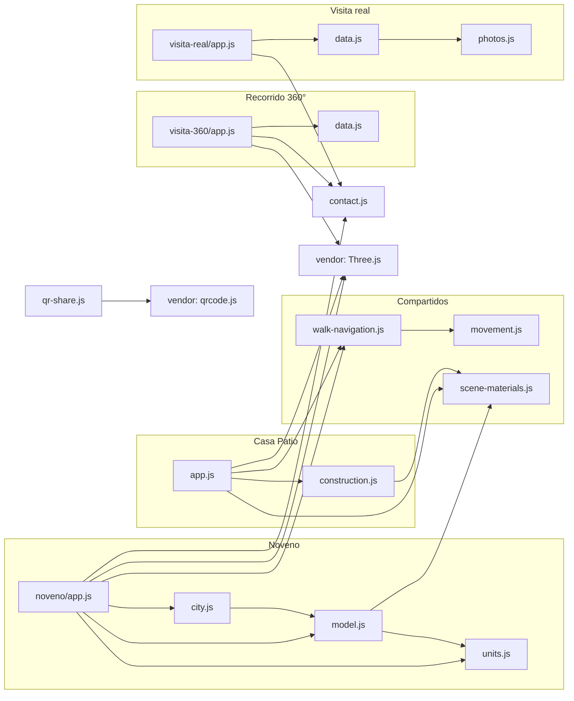

# Documentación técnica

Cómo está construido el sitio, cómo se prueba y se publica, y qué tener en cuenta al modificarlo.

## Principios

- **Sitio estático.** HTML, CSS y módulos JavaScript nativos del navegador. No hay compilación, framework ni dependencias de npm.
- **Todo incluido.** Three.js 0.164.1 y la tipografía DM Sans están en `dist/vendor/`. Al navegar no se descargan recursos de otros sitios; los únicos enlaces externos son los de créditos y licencias.
- **Sin servidor de aplicación.** No hay base de datos, cuentas ni claves: el contenido de cada demo está en sus módulos de datos o en su código.
- **Lo publicado es `dist/`.** La documentación, las pruebas y los scripts quedan en el repositorio y no se sirven en GitHub Pages.

## Mapa del repositorio

```text
.
├── README.md                    Portada del proyecto
├── CHANGELOG.md                 Historial de versiones y verificaciones
├── LICENSE                      Todos los derechos reservados; excepciones de terceros
├── package.json                 Scripts: npm start (servidor local) y npm test
├── .github/workflows/pages.yml  Comprobaciones y publicación en GitHub Pages
├── scripts/
│   └── ABRIR_PROTOTIPO.command  Lanzador para Mac (doble clic)
├── tests/                       Pruebas con node:test, sin dependencias
├── docs/                        Documentación (no se publica en Pages)
└── dist/                        El sitio publicado
    ├── index.html · app.js · construction.js · styles.css    Casa Patio
    ├── walk-navigation.js · movement.js · scene-materials.js Módulos compartidos
    ├── shared.css               Encabezado, menú, botón de WhatsApp y diálogo QR comunes
    ├── contact.js               Número de WhatsApp y armado del enlace de consulta
    ├── qr-share.js              Botón «Abrir en el celular» con el QR de la vista actual
    ├── og/                      Imágenes de vista previa para WhatsApp y redes (1200 × 630)
    ├── favicon.svg · .nojekyll
    ├── noveno/                  Noveno: units.js, model.js, city.js, app.js
    ├── visita-real/             Visita real: data.js, photos.js, app.js, photos/
    ├── visita-360/              Recorrido 360°: data.js, app.js, panoramas/
    └── vendor/                  Three.js, OrbitControls, RoundedBoxGeometry, RoomEnvironment, DM Sans, generador de QR y licencias
```

## Cómo se conectan los módulos



- Casa Patio y Noveno resuelven `import 'three'` con un *import map* declarado en su `index.html`, que apunta a `vendor/three.module.js`.
- `walk-navigation.js` y `movement.js` son el recorrido a pie y las colisiones de **ambas** demos 3D: un cambio ahí afecta a las dos.
- Visita real no usa Three.js ni los módulos 3D compartidos. El Recorrido 360° usa Three.js para la esfera del panorama, pero no los módulos de recorrido a pie.
- `contact.js` arma el enlace de «Consultar por WhatsApp» de Noveno y Visita real. `qr-share.js` agrega a los tres encabezados el botón «Abrir en el celular», que muestra el QR de la dirección actual; solo aparece en pantallas de más de 760 px.
- Cada `index.html` declara su vista previa (Open Graph): título, descripción e imagen de `dist/og/`. WhatsApp exige direcciones absolutas, así que apuntan al sitio publicado; si cambia el dominio, hay que actualizarlas.
- Las tres páginas comparten el encabezado: cargan `shared.css` después de su propio CSS, con el mismo logo, el mismo lema y un menú de demos que marca la actual con `aria-current`.
- Noveno encuadra la cámara solo: al cambiar de vista proyecta la caja de la maqueta y aleja la cámara si no entra en el visor. Con visores de menos de 600 px las etiquetas de las unidades pasan a modo compacto.

## Enlaces públicos

| Demo | Parámetros | Ejemplo |
| --- | --- | --- |
| Casa Patio | Ninguno | `/` |
| Noveno | `unidad` (`9a`, `9b`, `9c`) · `vista` (`edificio`, `piso`, `unidad`, `recorrido`) | `/noveno/?unidad=9c&vista=recorrido` |
| Visita real | `ambiente` · `foto` · `vista=plano` | `/visita-real/?ambiente=bano&foto=bano-ducha` |
| Recorrido 360° | `escena` (`terraza`, `living`, `dormitorio`) | `/visita-360/?escena=dormitorio` |

Los valores desconocidos o mal formados caen en un valor por defecto seguro y nunca se insertan en la página; las pruebas lo cubren. El detalle está en las fichas de [Noveno](../demos/noveno.md#enlaces-para-compartir) y [Visita real](../demos/visita-real.md#enlaces-para-compartir).

## Configurar el contacto por WhatsApp

El número se configura en un solo lugar, [dist/contact.js](../../dist/contact.js):

```js
export const whatsappNumber = '5493511234567'; // código de país y de área, sin espacios ni signos
```

Con el número vacío, el botón abre WhatsApp con el mensaje escrito y la persona elige a quién enviarlo; sirve para mostrar el flujo en una demo. El mensaje incluye la unidad o el ambiente que se estaba viendo y el enlace para volver a esa misma vista.

## Desarrollo local

```sh
npm start
# equivale a: python3 -m http.server 4173 --bind 127.0.0.1 --directory dist
```

Abrir http://127.0.0.1:4173. En Mac también se puede hacer doble clic en `scripts/ABRIR_PROTOTIPO.command`, que levanta el mismo servidor y abre el navegador.

Hace falta servir por HTTP: los navegadores no cargan módulos JavaScript abiertos directamente como archivo (`file://`).

## Pruebas

```sh
npm test
```

Usa el ejecutor de pruebas integrado en Node.js (versión 20 o posterior), sin instalar nada. Hay **29 pruebas**:

| Archivo | Pruebas | Qué cubre |
| --- | --- | --- |
| [tests/movement.test.mjs](../../tests/movement.test.mjs) | 7 | Colisiones: paso por puertas, paredes en movimientos largos, deslizamiento, distancia a los marcos, muebles, límites y regreso |
| [tests/noveno.test.mjs](../../tests/noveno.test.mjs) | 6 | Enlaces y valores inválidos, puntos de entrada libres, puertas conectadas, salida al balcón, unidades sin superposición |
| [tests/contact.test.mjs](../../tests/contact.test.mjs) | 4 | Enlace de WhatsApp: número solo con dígitos, mensaje codificado, comportamiento sin número |
| [tests/paginas.test.mjs](../../tests/paginas.test.mjs) | 2 | Las cuatro páginas comparten encabezado, menú (con enlaces entre todas) y módulo QR; cada una tiene vista previa con una imagen JPEG existente de menos de 300 KB |
| [tests/visita-360.test.mjs](../../tests/visita-360.test.mjs) | 4 | Panoramas JPEG 2:1 de 4096 px con fuente; puntos de paso válidos y todas las escenas alcanzables; enlaces seguros; ángulos y límites de la vista |
| [tests/visita-real.test.mjs](../../tests/visita-real.test.mjs) | 6 | Fotos locales con autor, fuente y licencia; recorrido completo y puntos de enlace; enlaces compartidos seguros; límites del zoom; plano dentro de su lienzo; visor sin datos de la propiedad escritos en el código |

Las pruebas cubren la lógica sin navegador. El renderizado y la interacción de Casa Patio y Noveno se verificaron con Chrome y Playwright al cerrar sus versiones; esas verificaciones están registradas en el [CHANGELOG](../../CHANGELOG.md) y no se ejecutan en GitHub Actions.

## Publicación

El workflow [pages.yml](../../.github/workflows/pages.yml) publica en https://geroo03.github.io/inmobiliaria-c-rdoba-3D/.

1. **Cuándo corre:** al subir a `main` cambios en `dist/`, `tests/`, `package.json` o el propio workflow, o a mano desde **Actions → Publicar en GitHub Pages → Run workflow**. Los cambios solo de documentación no vuelven a publicar el sitio.
2. **Qué comprueba:** que existan los archivos clave de las tres demos, que cada módulo JavaScript tenga sintaxis válida (`node --check`) y que pasen las pruebas.
3. **Qué publica:** únicamente `dist/`. El archivo `.nojekyll` evita que GitHub Pages procese el sitio con Jekyll.

Requisito único en GitHub: **Settings → Pages → Build and deployment → Source: GitHub Actions**. Cada publicación queda registrada en la [pestaña Actions](https://github.com/geroo03/inmobiliaria-c-rdoba-3D/actions).

## Agregar una demo o propiedad nueva

1. Crear `dist/<nombre>/` con su `index.html`, estilos y módulos. Para una propiedad con fotos, partir de una copia de `visita-real/` ([guía de adaptación](../demos/visita-real.md#cómo-adaptarla-a-una-propiedad-propia)).
2. Cargar `shared.css` y sumar su enlace al menú `demo-nav` del encabezado de todas las páginas.
3. Agregar `tests/<nombre>.test.mjs` para sus datos y enlaces, y la página a la lista de `tests/paginas.test.mjs`.
4. Declarar su vista previa (etiquetas `og:` en el `<head>`) con una imagen de 1200 × 630 en `dist/og/`.
5. En `pages.yml`, sumar su `index.html` a las comprobaciones y su carpeta al bucle de `node --check` (hoy recorre `dist/*.js`, `dist/noveno/*.js`, `dist/visita-real/*.js` y `dist/visita-360/*.js`).
6. Sumarla a la tabla de demos del [README](../../README.md), crear su ficha en `docs/demos/` y registrar el cambio en el [CHANGELOG](../../CHANGELOG.md).
7. Si incluye material de terceros, registrar autor, fuente y licencia en [créditos y licencias](../creditos-y-licencias.md).

## Estado de calidad

**Verificado:**

- Pruebas automáticas en cada publicación.
- Revisión visual con Playwright en Chrome y WebKit (el motor de Safari): las 4 demos en 7 tamaños (1440 × 900, 1280 × 720, iPad vertical y horizontal, iPhone 14, Pixel 7 y 360 px), sin errores de JavaScript, recursos rotos, desbordes horizontales ni textos recortados, y 26 interacciones recorridas en laptop y iPhone.
- Funciones de presentación: el QR, leído con el decodificador de Chrome, devuelve la dirección exacta de la vista en las tres demos; los mensajes de WhatsApp cambian con la unidad o el ambiente; con el diálogo abierto, Escape no saca de la caminata.
- Comprobaciones funcionales anteriores de Casa Patio y Noveno (detalle en el [CHANGELOG](../../CHANGELOG.md)).

**Pendiente:**

- Probar en teléfonos físicos, sobre todo Safari de iPhone y un Android de gama media. La emulación reproduce tamaños, pantalla táctil y el motor de Safari, pero no el rendimiento real de la GPU ni las particularidades de iOS.
- Medir la carga con conexiones móviles lentas.
- Hacer una auditoría completa de accesibilidad.
- Medir el rendimiento con material real (panoramas o modelos capturados): las demos actuales no permiten estimarlo.
